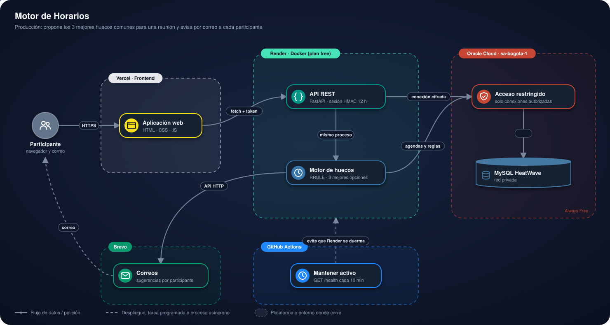

# Coordinador de reuniones (motor de horarios)

<p>
  <a href="https://motor-horarios-oci.vercel.app"></a>
  <a href="https://frontend-nine-topaz-99.vercel.app"></a>
  <a href="https://d4i3vsgw7xwmh.cloudfront.net"></a>
</p>


> 📘 **[Manual de usuario](docs/MANUAL.md)**: cómo usar cada pantalla, paso a paso y con imágenes.

## Contenido

1. [Presentación](#1-presentación)
2. [Funcionalidades](#2-funcionalidades)
3. [Arquitectura](#3-arquitectura)
4. [Estructura del proyecto](#4-estructura-del-proyecto)
5. [Instalación para pruebas](#5-instalación-para-pruebas)
6. [Autor y licencia](#6-autor-y-licencia)

---

## 1. Presentación

Coordina reuniones entre varias personas: cada usuario registra sus bloques ocupados o preferidos
(con repetición) y sus reglas de horario; el motor cruza las agendas, propone los 3 mejores huecos
comunes y avisa por correo a cada participante.

- **Qué hace:** en lugar de mandar correos preguntando "¿cuándo puedes?", cada persona registra
  una sola vez su horario y sus bloques. Al proponer una reunión, el motor sugiere los mejores
  horarios en que todos están libres; el organizador confirma, recalcula o cancela.
- **Cómo probarlo:** entra a la [demo](https://motor-horarios-oci.vercel.app), crea una cuenta,
  llena tu agenda y propone una reunión. La primera carga puede tardar unos segundos mientras el
  servicio se reactiva.

## 2. Funcionalidades

- Registro e ingreso con verificación en dos pasos obligatoria (app autenticadora o código por correo).
- Recuperación de la contraseña y del autenticador por correo.
- Horario laboral, días laborables y bloques ocupados o preferidos, puntuales o recurrentes.
- Propuesta de reuniones con las 3 mejores sugerencias ordenadas por puntaje.
- Confirmación, recálculo y cancelación; avisos por correo a los participantes.
- Adaptable a celular, tablet y computador, tema claro y oscuro, e instalable como aplicación.

## 3. Arquitectura

<p align="center">
  
</p>

| Capa | Tecnología |
|---|---|
| Interfaz | HTML, CSS y JavaScript estáticos |
| API y motor | FastAPI; el motor de huecos corre en el mismo proceso |
| Recurrencia | Reglas de repetición (RRULE) |
| Datos | MySQL |
| Avisos | Correo a cada participante |

El motor recorre la ventana de búsqueda en pasos, descarta los horarios fuera de las reglas de cada
persona o que chocan con sus bloques ocupados, puntúa los que caen en bloques preferidos y devuelve
los 3 mejores. Las fechas se interpretan en la hora de Bogotá.

## 4. Estructura del proyecto

| Carpeta | Contenido |
|---|---|
| `functions/api` | API (FastAPI) |
| `functions/motor` | Cálculo de huecos, recurrencia y correos |
| `frontend` | Páginas estáticas con el sistema de diseño del portafolio |
| `db` | Esquema de la base y datos de ejemplo para desarrollo |
| `docs` | Manual de usuario y diagramas |

## 5. Instalación para pruebas

Requisitos: Python 3.12 y una base MySQL 8 propia.

```bash
python -m venv .venv
.venv\Scripts\Activate.ps1        # Windows (en Linux o macOS: source .venv/bin/activate)
pip install -r functions/api/requirements.txt -r functions/motor/requirements.txt
```

Define como variables de entorno los datos de conexión de tu base y un secreto de sesión propio
(los nombres están en `functions/api/db.py` y `functions/api/auth.py`).

Crea las tablas con los archivos de `db/` en orden, levanta la API con
`uvicorn main:app --reload --app-dir functions/api` y abre `frontend/login.html` con un servidor
local. `frontend/js/config.js` usa `http://localhost:8000` cuando se abre en local. Nunca subas
credenciales al repositorio.

## 6. Autor y licencia

**Luis F. A.** · [GitHub](https://github.com/lariasca1994) · [LinkedIn](https://linkedin.com/in/lfac1)

Contacto: Telegram [@lfac6](https://t.me/lfac6) · WhatsApp [@carraian160](https://wa.me/carraian160) ·
[ariascluisf@hotmail.com](mailto:ariascluisf@hotmail.com)

Licencia: MIT.
