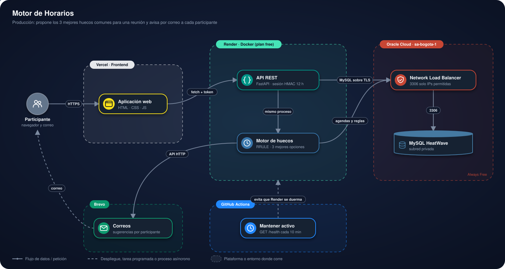
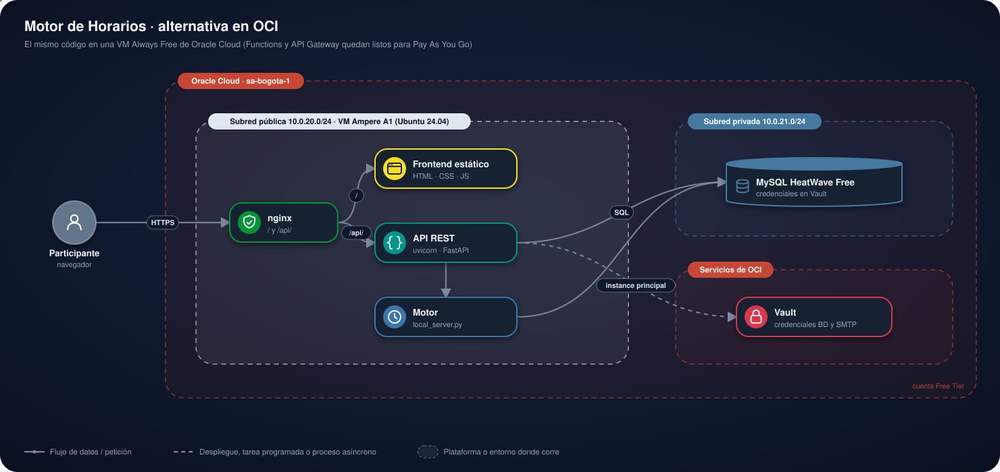

# Motor de Horarios sobre OCI

<p>
  <a href="https://motor-horarios-oci.vercel.app"></a>
  <a href="https://frontend-nine-topaz-99.vercel.app"></a>
  <a href="https://d4i3vsgw7xwmh.cloudfront.net"></a>
</p>


## Contenido

1. [Presentación](#1-presentación)
2. [Estructura del proyecto](#2-estructura-del-proyecto)
3. [Arquitectura](#3-arquitectura)
4. [Plataformas y su función](#4-plataformas-y-su-función)
5. [Cómo usar la plataforma](#5-cómo-usar-la-plataforma)
6. [Instalación para pruebas](#6-instalación-para-pruebas)
7. [Autor y licencia](#7-autor-y-licencia)

---

## 1. Presentación

> 🚧 **En desarrollo:** la versión publicada funciona, pero todavía se están
> ajustando detalles.

Coordina reuniones entre varias personas: cada usuario registra sus bloques
ocupados/preferidos (con recurrencia RRULE) y sus reglas (horario y días
laborables); el motor propone los 3 mejores huecos comunes y avisa por
correo (SMTP) a cada persona seleccionada.

### En pocas palabras

- **Qué hace:** en lugar de mandar correos preguntando "¿cuándo puedes?", cada
  persona registra una sola vez su horario laboral y sus bloques ocupados o
  preferidos. Al proponer una reunión, el motor cruza las agendas de todos los
  participantes y sugiere **los 3 mejores horarios** en que todos están libres.
- **Qué pasa después:** cada participante recibe las sugerencias por correo; el
  organizador confirma, recalcula o cancela desde la aplicación.
- **Cómo probarlo:** entra a la [demo](https://motor-horarios-oci.vercel.app),
  crea una cuenta en *Registro*, llena tu agenda y propone una reunión. La
  primera carga puede tardar ~50 s si el servidor estaba dormido. Para correrlo
  en tu equipo, ve a [Instalación para pruebas](#6-instalación-para-pruebas).

### Acceso

Todo requiere iniciar sesión (salvo la portada y `/health`). Cualquiera puede crear su
cuenta en `registro.html`; las cuentas nuevas empiezan con horario 8:00–18:00 de lunes a
viernes. Cada persona ve las reuniones que organiza o en las que participa y gestiona su
propia agenda. Contraseñas con scrypt; verificación en dos pasos obligatoria (app
autenticadora o código por correo, a elección); sesión con token firmado (HMAC-SHA256, 12 h).

Las cuentas iniciales de la demo se cargan desde un archivo privado (no versionado) con
`local/crear_usuarios.py`, sin sobrescribir contraseñas ya cambiadas. Cada participante
recibe por correo (Brevo) las sugerencias de sus reuniones.

---

## 2. Estructura del proyecto

| Carpeta | Contenido |
|---|---|
| `functions/api` | API REST (FastAPI) y autenticación. |
| `functions/motor` | Cálculo de huecos (`motor.py`), RRULE, `procesamiento.py`, correos. |
| `frontend` | HTML/CSS/JS estático (Vercel). La URL de la API está en `js/config.js`. |
| `db` | `001_esquema.sql` (tablas), `002_datos_demo.sql` (solo desarrollo) y `003_reglas_por_defecto.sql` y `004_verificacion_dos_pasos.sql` (migraciones, con la cuenta administradora). |
| `deploy` | Scripts de OCI (red, MySQL, Vault, NLB). |
| `local` | Scripts para crear la base y levantar todo en el equipo. |

### Frontend

Páginas estáticas con el mismo sistema de diseño que los demás proyectos del portafolio
(barra con tema claro/oscuro, portada con insignias, tarjetas de formulario). El color de
acento identifica la base de datos: azul MySQL (`#00758f`).

| Página | Contenido |
|---|---|
| `index.html` | Portada |
| `login.html` / `registro.html` | Ingreso y registro público |
| `reuniones.html` | Proponer reuniones, ver sugerencias, confirmar / recalcular / cancelar |
| `agenda.html` | Horario laboral, días laborables y bloques ocupados/preferidos (puntuales o recurrentes) |
| `clave.html` | Cambio de contraseña |
| `verificacion.html` | Segundo paso del ingreso: elegir y confirmar el método, o escribir el código |
| `seguridad.html` | Agregar el otro método de verificación y elegir el preferido |

`js/config.js` usa `http://localhost:8000` en local y la API de Render en producción.

---

## 3. Arquitectura

### Producción

<p align="center">
  
</p>

- El frontend estático habla con la API mediante `fetch` y un token de sesión.
- La API FastAPI y el motor de huecos corren en el mismo proceso.
- MySQL HeatWave vive en una subred privada; un Network Load Balancer publica el
  puerto 3306 solo para las IPs permitidas, y la conexión va cifrada con TLS y
  certificado fijado.

Render suspende el servicio tras 15 min sin tráfico: la primera petición tarda ~50 s.
Las fechas se guardan sin zona horaria y se interpretan como hora de Bogotá.

### Infraestructura en OCI

El despliegue usa una VM en Oracle Cloud con el mismo código:

<p align="center">
  
</p>

Scripts en `deploy/` (bash, OCI CLI). Los identificadores y claves que generan
quedan en archivos locales que no se suben a git.

| Script | Crea |
|---|---|
| `01_red.sh` | Subredes, rutas y reglas de red |
| `02_mysql.sh` | MySQL HeatWave |
| `03_iam_vault.sh` | Dynamic group + política, Vault + llave |
| `04_vm.sh` | VM A1 con reintentos por falta de capacidad |
| `05_desplegar.sh` | Sube el código, crea BD y secreto (primera vez) y reinicia servicios. Reejecutar para desplegar cambios |
| `06_nlb_mysql.sh` | NLB que publica MySQL solo para las IPs permitidas (`PERMITIR_IPS`) |

La arquitectura con OCI Functions + API Gateway (`functions/*/func.py`, `Dockerfile`,
`func.yaml`) queda lista como alternativa.

`Dockerfile` y `render.yaml` de la raíz son opcionales (API en Render, sin motor).

---

## 4. Plataformas y su función

| Plataforma | Función en el proyecto |
|---|---|
|  | Sirve el frontend estático (HTML, CSS y JavaScript). |
|  | Corre la API FastAPI y el motor de huecos en el mismo proceso. |
|  | Aloja la base en una subred privada, el Network Load Balancer que la publica de forma restringida, el Vault de credenciales y la VM alternativa. |
|  | Guarda usuarios, reglas de horario, bloques de agenda, reuniones y sugerencias. |
|  | Envía a cada participante las sugerencias de sus reuniones. |
|  | El flujo `.github/workflows/mantener-activo.yml` consulta `/health` cada 10 minutos de lunes a viernes de 7:00 a 19:00 (Bogotá) para que Render no se suspenda en horario laboral; fuera de ese horario duerme y ahorra horas gratuitas. |

---

## 5. Cómo usar la plataforma

### 5.1 Crear una cuenta

1. En la portada, pulsa **Crear cuenta**.
2. Completa **Nombre**, **Correo**, **Contraseña (mínimo 10 caracteres)** y
   **Confirmar contraseña**.
3. Pulsa **Crear cuenta** y elige tu verificación en dos pasos: **App autenticadora**
   (escanea el QR y escribe el primer código) o **Código por correo**. La cuenta empieza con
   horario de 8:00 a 18:00, de lunes a viernes.

### 5.2 Iniciar sesión

1. Pulsa **Ya tengo cuenta**, escribe **Correo** y **Contraseña** y pulsa **Ingresar**.
2. Escribe el código de 6 dígitos de tu app o de tu correo y pulsa **Verificar**. En
   **Seguridad** puedes agregar el otro método y elegir cuál se pide por defecto.
3. La sesión dura 12 horas.
4. ¿La olvidaste? Pulsa **¿Olvidaste tu contraseña?** y escribe tu correo: si la cuenta existe,
   llega un enlace (API de Brevo) que vence en 30 minutos y sirve una sola vez.

### 5.3 Llenar tu agenda

En **Mi agenda**:

1. **Horario laboral:** define **Desde**, **Hasta** y los **Días laborables**, y pulsa
   **Guardar horario**.
2. **Bloques de agenda:** pulsa **Agregar bloque** y completa:

   | Campo | Dato |
   |---|---|
   | Descripción | Por ejemplo "Daily", "almuerzo" o "clase" |
   | Tipo | Ocupado (no agendar aquí) o Preferido (mejor si es aquí) |
   | Fecha (primera vez) | Día en que ocurre por primera vez |
   | Hora inicio / Hora fin | Franja del bloque |
   | Repetición | No se repite, Todos los días, Días laborables (lunes a viernes) o Semanal, estos días… |
   | Días de la semana | Solo con repetición semanal |
   | Repetir hasta (opcional) | Fecha en que deja de repetirse |

3. Pulsa **Agregar bloque**.

### 5.4 Proponer una reunión

1. En **Mis reuniones**, ve a **Proponer reunión** y completa:

   | Campo | Dato |
   |---|---|
   | Título | Tema de la reunión |
   | Duración (minutos) | Cuánto dura |
   | Buscar desde / Hasta | Rango de fechas donde buscar |
   | Organizador | Quién la organiza |
   | Participantes | Personas invitadas; recibirán el correo |

2. Pulsa **Buscar huecos**. El motor cruza las agendas y propone los 3 mejores
   horarios comunes, y cada participante recibe las sugerencias por correo.
3. Desde la reunión, el organizador puede **confirmar** un horario, **recalcular** las
   sugerencias o **cancelar** la reunión.

### 5.5 Cambiar la contraseña

En **Cambiar contraseña**, escribe la **Contraseña actual**, la **Nueva contraseña
(mínimo 10 caracteres)** y su confirmación, y pulsa **Guardar**.

### Si el servicio no responde

Si la API o la base de datos (MySQL HeatWave en Oracle Cloud) no responden, la aplicación muestra una **pantalla de mantenimiento** con los colores del proyecto, en lugar de un error genérico o de una página que no carga.

- **Servidor:** La API responde **503** si MySQL no responde (`pymysql` `OperationalError`/`InterfaceError`).
- **Pantalla:** `frontend/js/comun.js` (`mostrarMantenimiento`): sin conexión con la API de Render, o con 502/503/504, oculta el contenido y muestra la pantalla.
- **Recuperación:** Consulta `/health` cada 15 s y recarga la página sola cuando la API vuelve. No reintenta acciones del usuario, para no duplicarlas.

---

## 6. Instalación para pruebas

Requisitos: Python 3.12.15+ y un MySQL 8 local (aquí: servicio `MySQL84`, puerto 3306).

```powershell
python -m venv .venv
.venv\Scripts\pip install -r functions\api\requirements.txt -r functions\motor\requirements.txt
.venv\Scripts\python local\crear_bd.py          # pide la clave de root; crea BD, usuario y local\.env
powershell -ExecutionPolicy Bypass -File local\iniciar.ps1
```

| Servicio | URL |
|---|---|
| Frontend | http://localhost:8080 |
| API (Swagger) | http://localhost:8000/docs |
| Motor | http://localhost:8001/health |

Para recrear la base: `.venv\Scripts\python local\crear_bd.py --reset`.
`docker-compose.yml` queda como alternativa para equipos con Docker.

### Variables de entorno

| Variable | Función | Valor |
|---|---|---|
| `DB_MODE` | ambas | `env` (local) o `vault` (OCI, por defecto) |
| `DB_HOST`, `DB_PORT`, `DB_USER`, `DB_PASSWORD`, `DB_NAME` | ambas | solo con `DB_MODE=env` |
| `DB_SSL_CA` / `DB_SSL_CA_PEM` | ambas | ruta o contenido del certificado (CA o certificado fijado) |
| `DB_SSL_CHECK_HOSTNAME` | ambas | `false` al conectarse por IP (NLB) |
| `DB_SECRET_OCID` | ambas | OCID del secreto JSON en Vault (`host`, `port`, `user`, `password`, `database`, `ssl_ca` opcional) |
| `MOTOR_MODE` | api | `inproceso` (Render), `http` (local), `oci` (Functions) u `off` |
| `MOTOR_URL` | api | URL del motor local |
| `MOTOR_FUNCTION_OCID`, `MOTOR_INVOKE_ENDPOINT` | api | para invocar el motor en OCI |
| `API_PATH_PREFIX` | api | prefijo del deployment de API Gateway, p. ej. `/horarios` |
| `CORS_ORIGINS` | api | orígenes permitidos separados por coma (`*` por defecto) |
| `AUTH_SECRET` | api | clave para firmar sesiones (obligatoria en producción) |
| `AUTH_TTL_HORAS` | api | duración de la sesión (12 por defecto) |
| `API_DOCS` | api | `true` para exponer `/docs` (desactivado por defecto) |
| `EMAIL_MODE` | motor | `log` (por defecto), `brevo_api` o `smtp` |
| `BREVO_API_KEY`, `EMAIL_FROM`, `EMAIL_FROM_NAME` | motor | envío por la API de Brevo |
| `SMTP_SECRET_OCID` | motor | secreto JSON en Vault con `host`, `port`, `user`, `password`, `from` |
| `SMTP_HOST`, `SMTP_PORT`, `SMTP_USER`, `SMTP_PASSWORD`, `EMAIL_FROM` | motor | SMTP sin Vault (local) |

---

## 7. Autor y licencia

> 📘 **[Manual de usuario](docs/MANUAL.md)**: cómo usar la plataforma campo por campo, qué datos se ingresan y qué garantiza en seguridad.

**Luis Felipe Arias Carriazo**
[GitHub](https://github.com/lariasca1994) · [LinkedIn](https://linkedin.com/in/lfac1)

Licencia: MIT.
