# 📘 Manual de usuario · Coordinador de reuniones

## 1. Portada

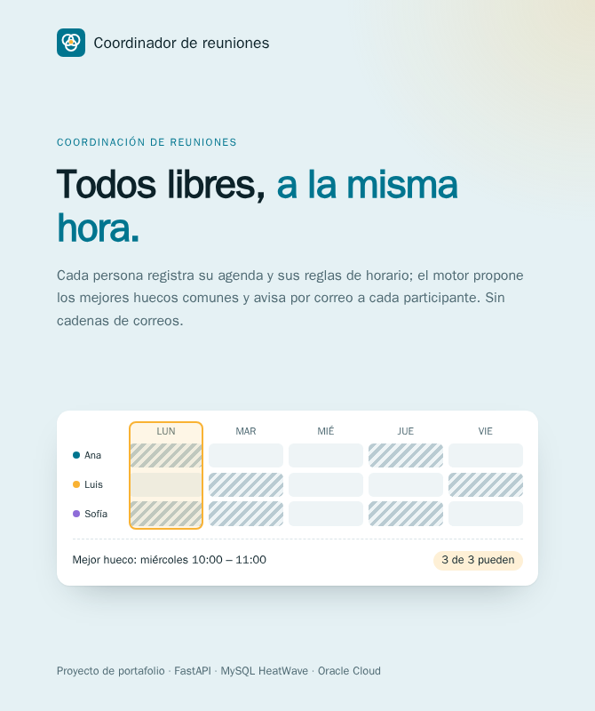

| | |
|---|---|
| **Producto** | Coordinador de reuniones |
| **Documento** | Manual de usuario |
| **Versión** | 2.0 · noviembre de 2026 |
| **Dirigido a** | Personas y equipos que necesitan acordar horarios de reunión |
| **Dirección** | [motor-horarios-oci.vercel.app](https://motor-horarios-oci.vercel.app) |
| **Autor** | Luis F. A. |

## Contenido

1. [Portada](#1-portada)
2. [Introducción](#2-introducción)
3. [Objetivo](#3-objetivo)
4. [Alcance](#4-alcance)
5. [Acceso al sistema](#5-acceso-al-sistema)
6. [Pantalla principal](#6-pantalla-principal)
7. [Navegación](#7-navegación)
8. [Funcionalidades](#8-funcionalidades)
9. [Gestión de perfil](#9-gestión-de-perfil)
10. [Mensajes frecuentes](#10-mensajes-frecuentes)
11. [Preguntas frecuentes](#11-preguntas-frecuentes)
12. [Glosario](#12-glosario)

---

## 2. Introducción

El **Coordinador de reuniones** acaba con las cadenas de correos para cuadrar un horario. Cada
persona registra su horario laboral y los bloques en los que está ocupada (o que prefiere); quien
organiza propone una reunión y el motor busca los mejores huecos en los que todos pueden asistir.
Al confirmar uno, cada participante recibe el aviso por correo.

Este manual explica cada pantalla, paso a paso y con imágenes.

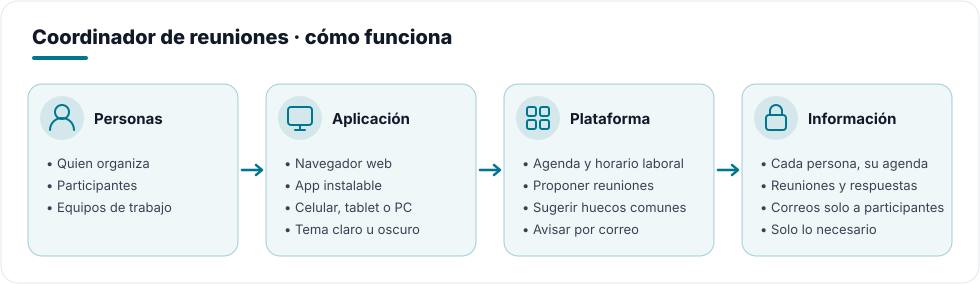

## 3. Objetivo

Que cualquier persona pueda, sin conocimientos técnicos:

- Crear su cuenta e ingresar de forma segura.
- Registrar su horario laboral y sus bloques ocupados o preferidos, incluso los que se repiten.
- Proponer una reunión, ver los mejores huecos comunes y confirmar uno.
- Seguir el estado de todas sus reuniones.

## 4. Alcance

**Incluye:** registro e ingreso con verificación en dos pasos, horario laboral, bloques de agenda
con repetición, propuesta de reuniones con sugerencias ordenadas por puntaje, confirmación,
recálculo y cancelación, avisos por correo, cambio de contraseña y métodos de verificación.

**No incluye:** sincronización con calendarios externos ni videollamadas.

**Qué necesitas:** un navegador actualizado, conexión a internet, un correo propio y una app
autenticadora en el celular (o acceso a tu correo para recibir códigos).

## 5. Acceso al sistema

### 5.1 Crear una cuenta

En la pantalla de ingreso pulsa **Regístrate**.

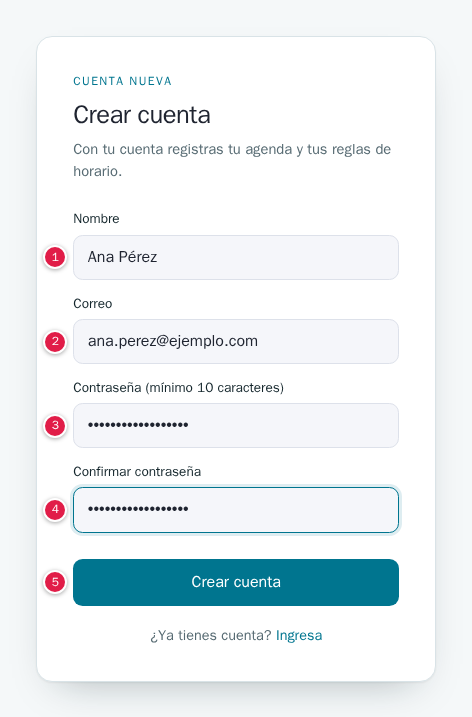

| # | Campo | Qué escribir |
|:-:|---|---|
| 1 | Nombre | Tu nombre, como lo verán los demás participantes |
| 2 | Correo | Un correo al que tengas acceso: ahí llegan los avisos de reuniones |
| 3 | Contraseña | Mínimo 10 caracteres |
| 4 | Confirmar contraseña | La misma contraseña |
| 5 | Crear cuenta | Crea tu cuenta y te lleva a configurar la verificación en dos pasos |

### 5.2 Iniciar sesión

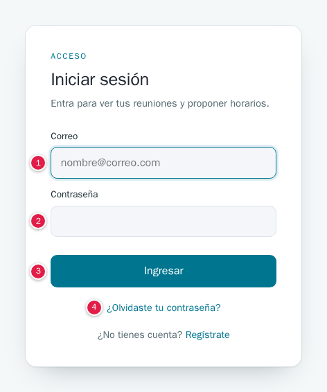

| # | Elemento | Qué hace |
|:-:|---|---|
| 1 | Correo | El correo de tu cuenta |
| 2 | Contraseña | Tu contraseña |
| 3 | Ingresar | Comprueba tus datos y pasa a la verificación en dos pasos |
| 4 | ¿Olvidaste tu contraseña? | Abre la recuperación de contraseña (5.4) |

### 5.3 Verificación en dos pasos

Cada ingreso pide, además de la contraseña, un código de 6 dígitos de tu **app autenticadora** o de
tu **correo**.

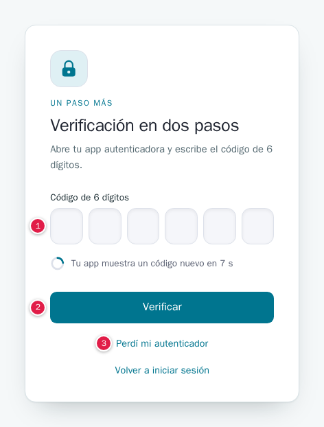

| # | Elemento | Qué hace |
|:-:|---|---|
| 1 | Código de 6 dígitos | El código que muestra tu app o que llegó a tu correo |
| 2 | Verificar | Confirma el código y abre la plataforma |
| 3 | Perdí mi autenticador | Si ya no tienes la app, te envía un código al correo para configurar una app nueva |

### 5.4 Recuperar la contraseña

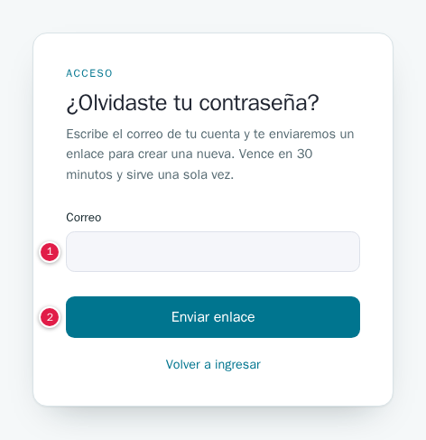

| # | Elemento | Qué hace |
|:-:|---|---|
| 1 | Correo | El correo de tu cuenta |
| 2 | Enviar enlace | Envía un enlace para crear una contraseña nueva (vence en 30 minutos y sirve una sola vez) |

## 6. Pantalla principal

Al ingresar se abre **Mis reuniones**.

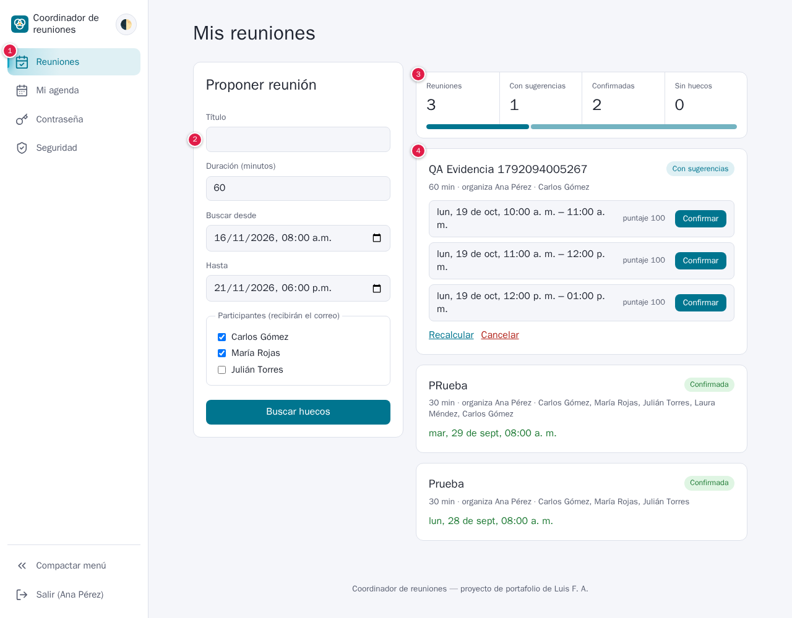

| # | Elemento | Qué hace |
|:-:|---|---|
| 1 | Menú lateral | Lleva a Reuniones, Mi agenda, Contraseña y Seguridad |
| 2 | Proponer reunión | Formulario para pedir al motor los mejores horarios (8.1) |
| 3 | Resumen | Cuántas reuniones tienes y en qué estado están |
| 4 | Lista de reuniones | Cada reunión con su estado, duración, organizador, participantes y sugerencias |

## 7. Navegación

En el computador el menú está a la izquierda; **Compactar menú** lo reduce a íconos. Al pie,
**Salir** cierra la sesión.

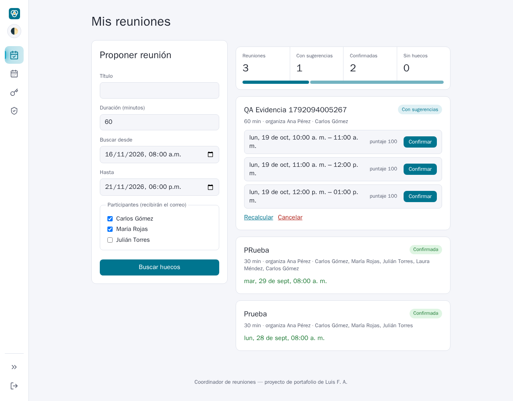

En la tablet en vertical y en el celular, el menú pasa a una barra inferior; **Más** abre una hoja
con Contraseña, Seguridad y Salir. El botón ◐ cambia entre tema claro y oscuro.

| Tablet en vertical | Celular con la hoja "Más" |
|:-:|:-:|
| 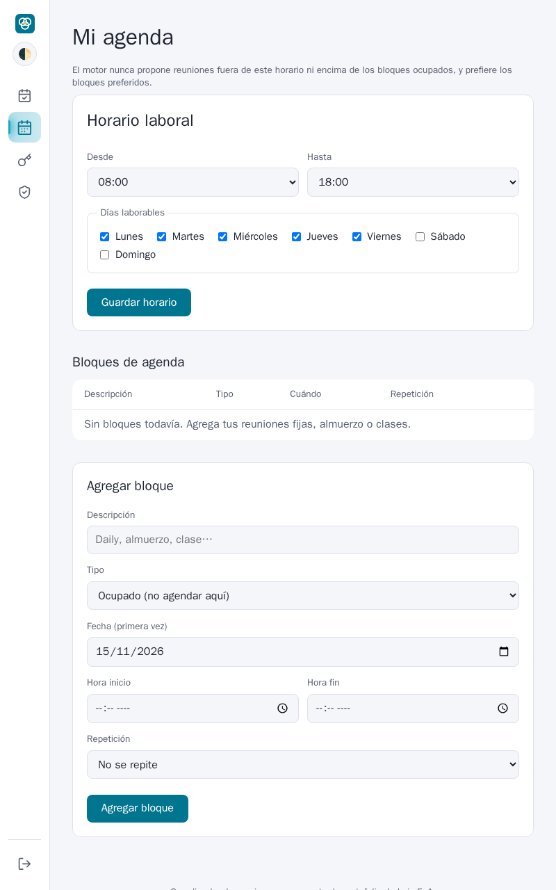 | 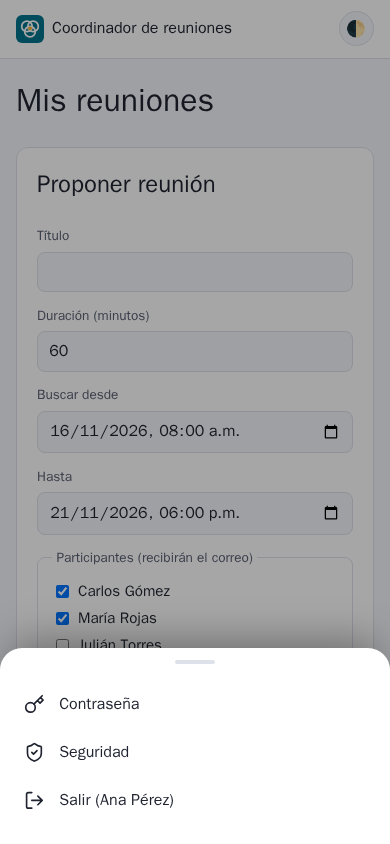 |

## 8. Funcionalidades

### 8.1 Crear: reuniones y bloques de agenda

**Reunión.** En **Mis reuniones**, completa **Proponer reunión**.

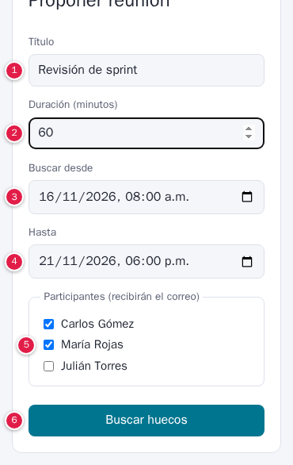

| # | Campo | Qué escribir |
|:-:|---|---|
| 1 | Título | De qué trata la reunión |
| 2 | Duración (minutos) | Cuánto dura |
| 3 | Buscar desde | Desde cuándo buscar huecos |
| 4 | Hasta | Hasta cuándo buscar |
| 5 | Participantes | Quiénes asisten; todos reciben el correo |
| 6 | Buscar huecos | Crea la reunión y el motor propone los mejores horarios |

**Bloque de agenda.** En **Mi agenda**, agrega tus reuniones fijas, almuerzo o clases.

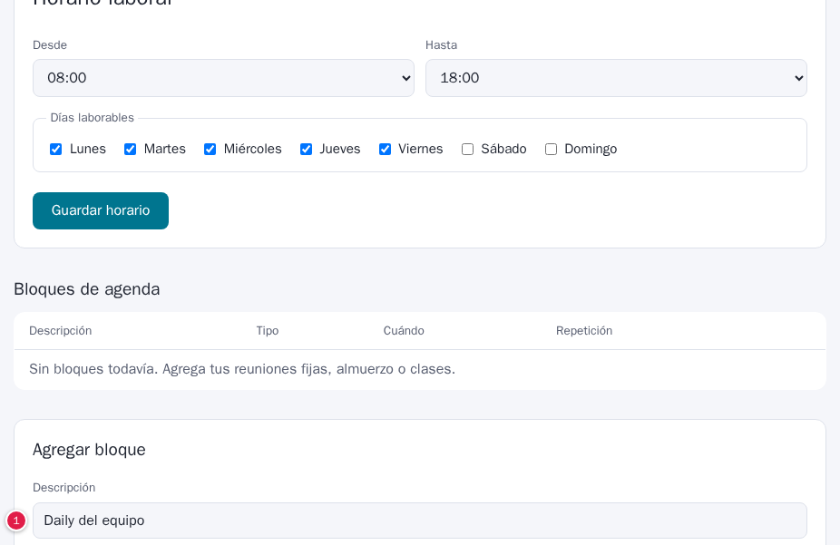

| # | Campo | Qué escribir |
|:-:|---|---|
| 1 | Descripción | Qué es el bloque (por ejemplo, Daily del equipo) |
| 2 | Tipo | **Ocupado** (el motor no agenda ahí) o **Preferido** (el motor lo prefiere) |
| 3 | Fecha (primera vez) | El primer día del bloque |
| 4 | Hora inicio | Cuándo empieza |
| 5 | Hora fin | Cuándo termina |
| 6 | Repetición | No se repite, todos los días, días laborables o semanal en los días que elijas |
| 7 | Repetir hasta | Opcional: hasta qué fecha se repite |
| 8 | Agregar bloque | Guarda el bloque |

### 8.2 Consultar: reuniones y sugerencias

Cada reunión muestra su estado y, si tiene sugerencias, los mejores horarios ordenados por puntaje.

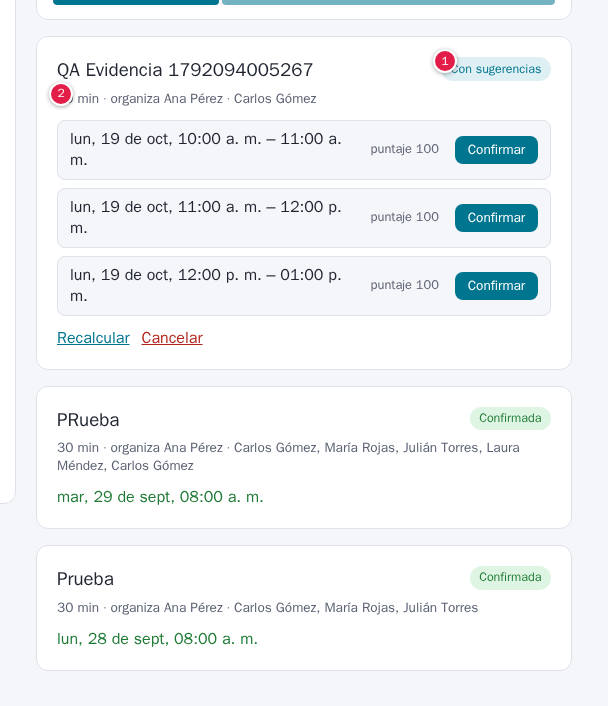

| # | Elemento | Qué muestra |
|:-:|---|---|
| 1 | Estado | **Con sugerencias**, **Confirmada**, **Sin huecos** o **Calculando** |
| 2 | Detalle | Duración, quién organiza y quiénes participan |

### 8.3 Modificar: confirmar, recalcular, cancelar y ajustar el horario

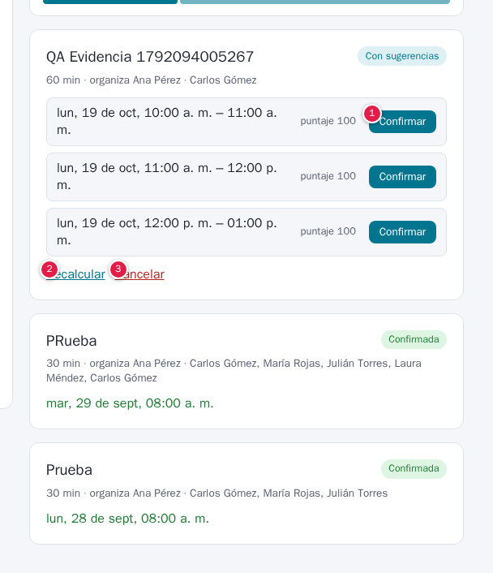

| # | Acción | Qué hace |
|:-:|---|---|
| 1 | Confirmar | Elige ese horario: la reunión queda confirmada y se avisa por correo a los participantes |
| 2 | Recalcular | Vuelve a buscar huecos con las agendas actuales |
| 3 | Cancelar | Cancela la reunión |

**Horario laboral.** En **Mi agenda** defines en qué horas y días se te pueden proponer reuniones.

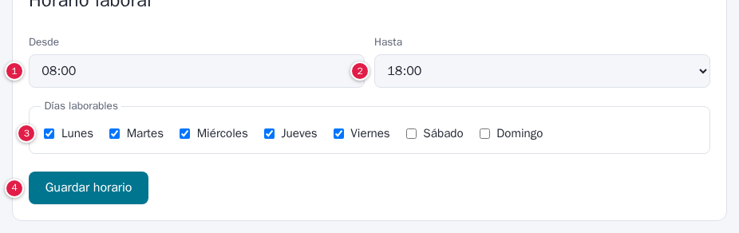

| # | Campo | Qué hace |
|:-:|---|---|
| 1 | Desde | Hora de inicio de tu jornada |
| 2 | Hasta | Hora de fin de tu jornada |
| 3 | Días laborables | Los días en que trabajas |
| 4 | Guardar horario | Guarda los cambios |

### 8.4 Reportar: resumen y avisos

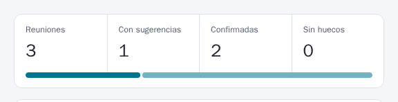

El resumen muestra cuántas reuniones tienes, cuántas tienen sugerencias, cuántas están confirmadas
y cuántas no encontraron huecos. Cada confirmación llega por correo a todos los participantes.

## 9. Gestión de perfil

### 9.1 Cambiar contraseña

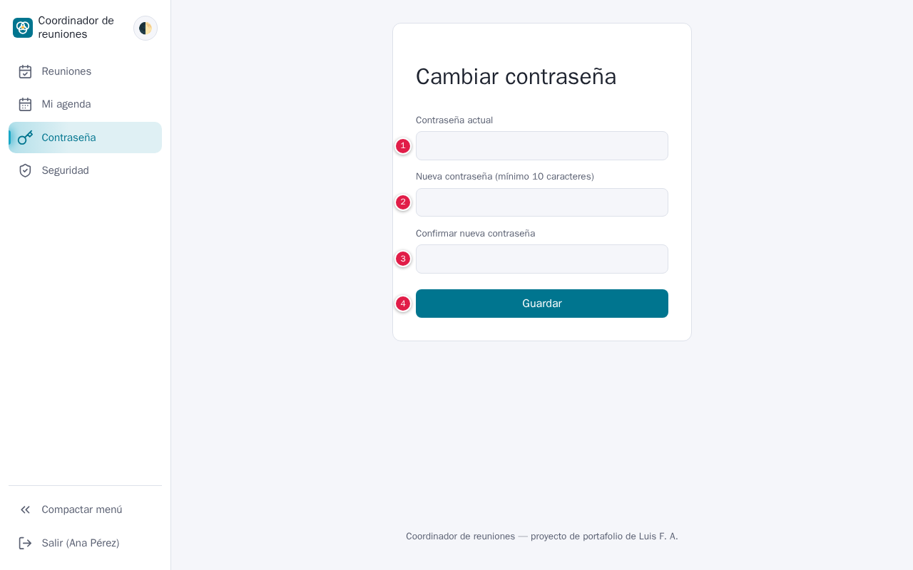

| # | Campo | Qué escribir |
|:-:|---|---|
| 1 | Contraseña actual | Tu contraseña de hoy |
| 2 | Nueva contraseña | Mínimo 10 caracteres |
| 3 | Confirmar nueva contraseña | La misma contraseña nueva |
| 4 | Guardar | Guarda el cambio |

### 9.2 Seguridad

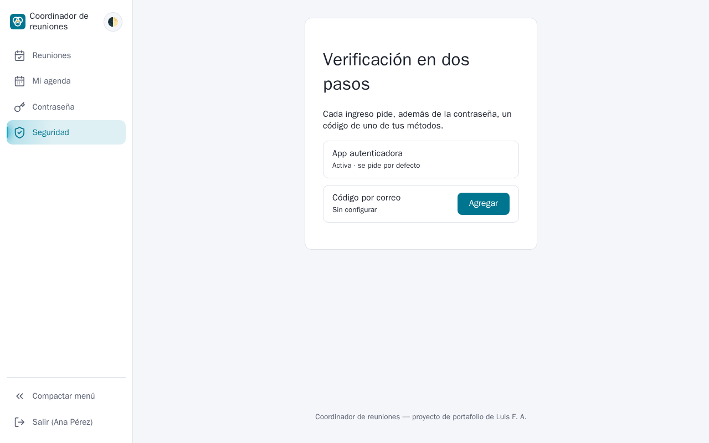

| Método | Qué puedes hacer |
|---|---|
| App autenticadora | Ver si está activa y si es el método que se pide por defecto |
| Código por correo | **Agregar** el método que te falta o **Pedir este por defecto** |

## 10. Mensajes frecuentes

| Mensaje | Qué significa | Qué hacer |
|---|---|---|
| correo o contraseña incorrectos | Los datos no coinciden | Revísalos o usa **¿Olvidaste tu contraseña?** |
| el código no es correcto o ya venció | El código escrito no es el vigente | Escribe el código que muestra ahora la app |
| pediste varios códigos seguidos; espera unos minutos | Se pidieron muchos códigos en poco tiempo | Espera unos minutos |
| Reunión "…" creada: Con sugerencias. | El motor encontró horarios | Revisa las sugerencias y confirma una |
| No hay un hueco común en la ventana. | Nadie coincide en esas fechas | Amplía las fechas o revisa las agendas |
| La hora de fin debe ser posterior a la de inicio. | El bloque está mal definido | Corrige las horas |
| Elige al menos un día laborable. | El horario no tiene días | Marca al menos un día |
| Las contraseñas no coinciden. | La contraseña y su confirmación son distintas | Escríbelas de nuevo |
| Tu sesión venció, ingresa de nuevo. | Pasó un tiempo sin actividad | Vuelve a ingresar |
| Página no encontrada | La dirección que abriste no existe | Vuelve con el menú |
| Sin conexión | Tu equipo no tiene internet | La pantalla reintenta sola |

| Página no encontrada | Sin conexión |
|:-:|:-:|
| 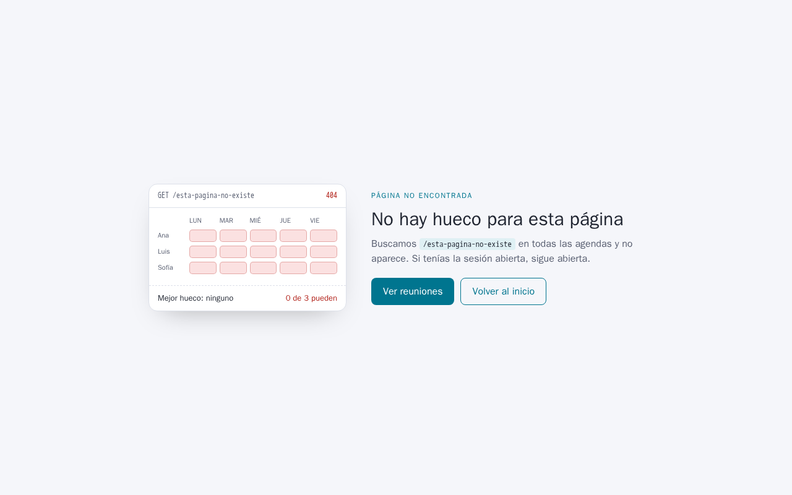 | 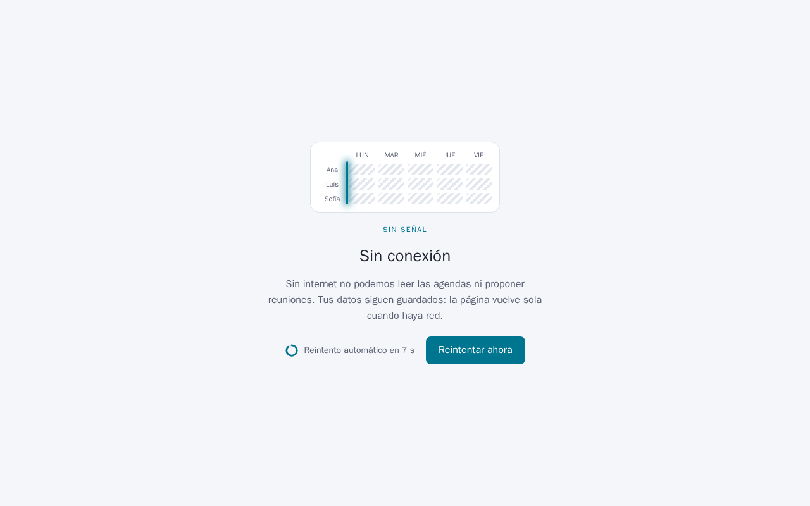 |

## 11. Preguntas frecuentes

**¿Por qué el motor no propone horarios?** Revisa que la ventana de búsqueda sea amplia y que los
participantes tengan días y horas laborales en común.

**¿Qué diferencia hay entre un bloque ocupado y uno preferido?** En los ocupados nunca se proponen
reuniones; los preferidos suben el puntaje de los huecos que caen en ellos.

**¿Por qué la primera carga tarda?** El servicio se suspende cuando nadie lo usa; la primera acción
lo reactiva.

**¿Se puede instalar como aplicación?** Sí: en Chrome o Edge, **Instalar aplicación**; en iPhone,
Safari → **Compartir → Agregar a inicio**.

**¿Dónde pido ayuda o reporto un problema?** Telegram [@lfac6](https://t.me/lfac6), WhatsApp
[@carraian160](https://wa.me/carraian160) o [ariascluisf@hotmail.com](mailto:ariascluisf@hotmail.com).

## 12. Glosario

| Término | Qué significa |
|---|---|
| **App autenticadora** | Aplicación del celular que muestra un código nuevo cada 30 segundos para confirmar que eres tú |
| **Bloque ocupado** | Franja de tu agenda en la que no se proponen reuniones |
| **Bloque preferido** | Franja en la que prefieres que se agenden reuniones |
| **Hueco común** | Horario en el que todos los participantes están libres |
| **Puntaje** | Qué tan buena es una sugerencia según las preferencias de los participantes |
| **Repetición** | Regla para que un bloque se repita (diario, laborables, semanal…) |
| **Verificación en dos pasos** | Además de la contraseña, se pide un código que solo tú puedes recibir |
