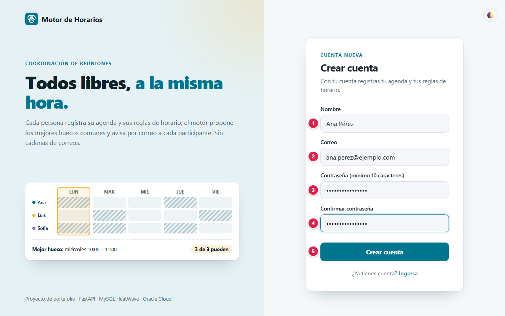
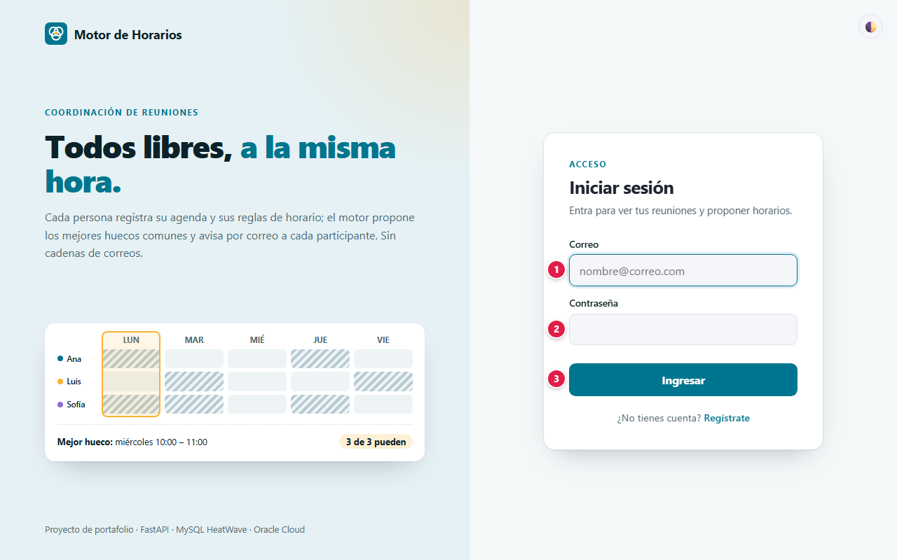
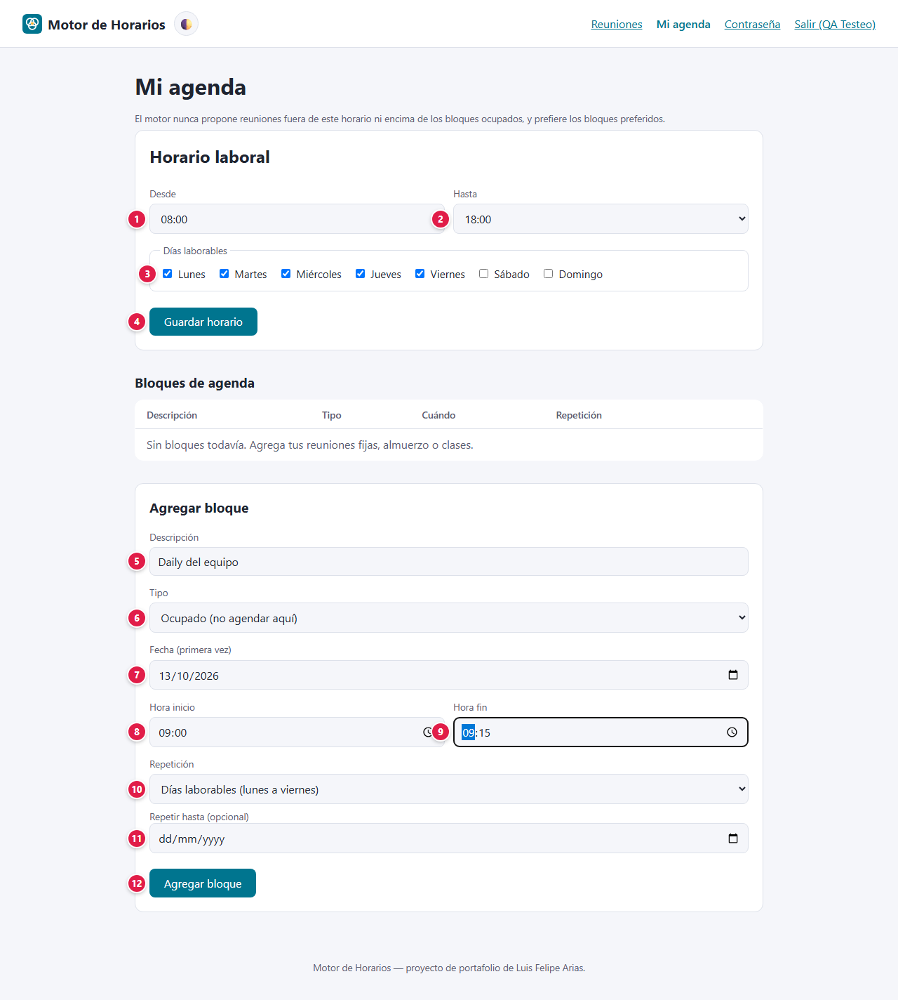
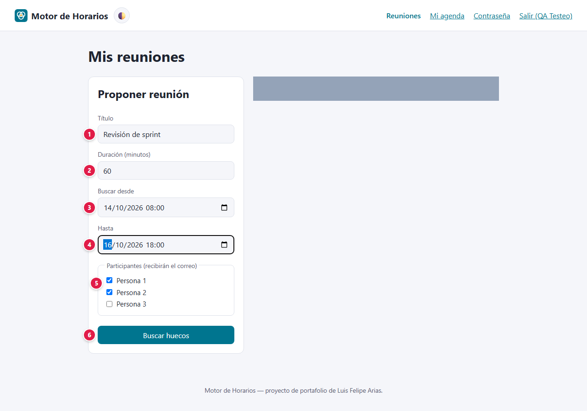
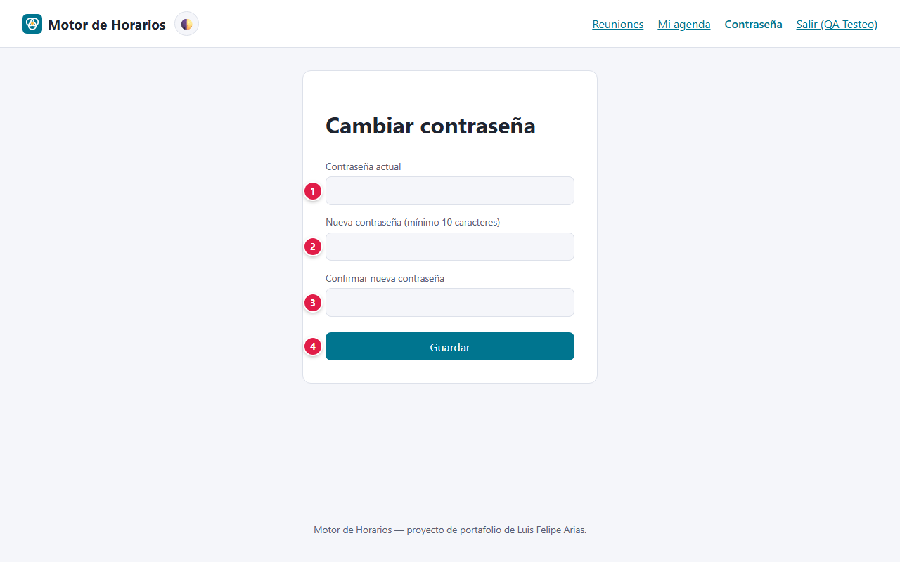

# 📘 Manual de usuario · Motor de Horarios

Guía para usar la plataforma paso a paso: qué significa cada campo, qué datos se ingresan y qué
protege la plataforma. Para la parte técnica vuelve al [README](../README.md).

**Demo:** [motor-horarios-oci.vercel.app](https://motor-horarios-oci.vercel.app)

## Contenido

1. [Proyecto: objetivos y alcances](#1-proyecto-objetivos-y-alcances)
2. [Glosario](#2-glosario)
3. [Plataformas, base de datos y servicios](#3-plataformas-base-de-datos-y-servicios)
4. [Paso a paso](#4-paso-a-paso)
5. [Seguridad: tu información protegida](#5-seguridad-tu-información-protegida)
6. [Agradecimientos](#6-agradecimientos)

---

## 1. Proyecto: objetivos y alcances

### Objetivo

Cada persona registra una sola vez su horario laboral y sus bloques ocupados o preferidos. Al
proponer una reunión, el motor cruza las agendas de los participantes y sugiere **los 3 mejores
horarios** en que todos están libres. Cada participante recibe las sugerencias por correo.

### Alcance: qué necesitas y qué esperar

- Solo necesitas un navegador.
- El servidor se duerme sin uso: la primera carga puede tardar **unos 50 segundos**.
- Las cuentas nuevas empiezan con horario de **8:00 a 18:00, de lunes a viernes**.

### Límites

Proyecto en desarrollo, pensado como demo de portafolio:

- No hay recuperación de contraseña por correo: guárdala en un gestor.
- El token vive en `localStorage`: usa **Salir** en equipos compartidos.
- Tu nombre es visible para todas las cuentas activas; usa un nombre que no te moleste mostrar.

## 2. Glosario

Palabras técnicas que aparecen en este manual, explicadas en lenguaje simple.

| Término | Qué significa |
|---|---|
| **Administrador** | Cuenta con permisos para gestionar usuarios y configuraciones de la aplicación. |
| **API** | Puerta de entrada de un programa para que otros programas le pidan o le envíen datos. |
| **Arranque en frío** | Los servidores gratuitos se apagan sin uso; la primera visita tarda unos segundos mientras vuelven a encenderse. |
| **Base de datos** | Lugar donde la aplicación guarda la información de forma ordenada y permanente. |
| **Captura de pantalla (evidencia)** | Imagen de lo que se veía en la pantalla, que sirve como prueba de lo que pasó. |
| **Cifrado / TLS / HTTPS** | Protección que codifica la información mientras viaja, para que nadie en el camino pueda leerla. |
| **Contraseña cifrada (hash)** | La contraseña no se guarda tal cual, sino como una "huella" de la que no se puede recuperar el texto original. |
| **CORS** | Regla que impide que páginas ajenas usen la API de la aplicación desde el navegador. |
| **Frontend** | La parte de la aplicación que ves y usas en el navegador. |
| **localStorage** | Espacio del navegador donde la aplicación guarda datos pequeños en tu equipo (por ejemplo, el tema o la sesión). |
| **Modo mantenimiento** | Pantalla que aparece cuando el servicio o su base de datos no responden; se recupera sola cuando vuelven. |
| **Navegador** | Programa con el que abres páginas web: Chrome, Edge, Firefox, Safari. |
| **Nube** | Servidores de una empresa (Amazon, Microsoft, Google, Oracle…) donde la aplicación funciona sin depender de un computador propio. |
| **Rate limit (límite de intentos)** | Tope de intentos en poco tiempo, para frenar a quien intenta adivinar contraseñas. |
| **Recurrencia (RRULE)** | Regla que indica cada cuánto se repite un evento (diario, semanal, días laborables…). |
| **Rol** | Tipo de cuenta que define qué puede hacer cada persona (por ejemplo, usuario o administrador). |
| **Servidor** | Computador en la nube que atiende las peticiones de la aplicación. |
| **Sesión** | El tiempo en que la aplicación te reconoce después de iniciar sesión, sin pedirte la contraseña de nuevo. |
| **Tema claro / oscuro** | Combinación de colores de la interfaz; puedes elegir la clara o la oscura. |
| **Token** | Credencial temporal que la aplicación te entrega al iniciar sesión, en lugar de enviar tu contraseña en cada paso. |
| **Variables de entorno / secretos** | Claves y contraseñas internas de la aplicación, guardadas fuera del código para que no queden expuestas. |

## 3. Plataformas, base de datos y servicios

Qué servicio de nube, base de datos o API usa el proyecto y para qué sirve cada uno.

| Plataforma | Tipo | Qué hace en el proyecto |
|---|---|---|
|  | Nube | Sirve el frontend estático (HTML, CSS y JavaScript). |
|  | Nube | Corre la API FastAPI y el motor de huecos en el mismo proceso. |
|  | Nube | Aloja la base en una subred privada, el Network Load Balancer que la publica de forma restringida, el Vault de credenciales y la VM alternativa. |
|  | Base de datos | Guarda usuarios, reglas de horario, bloques de agenda, reuniones y sugerencias. |
|  | API / servicio externo | Envía a cada participante las sugerencias de sus reuniones. |
|  | Automatización | El flujo `.github/workflows/mantener-activo.yml` consulta `/health` cada 10 minutos de lunes a viernes de 7:00 a 19:00 (Bogotá) para que Render no se suspenda en horario laboral; fuera de ese horario duerme y ahorra horas gratuitas. |

## 4. Paso a paso

### 4.1 Crear una cuenta

| # | Campo | Qué escribir | Reglas |
|:-:|---|---|---|
| 1 | Nombre | Tu nombre; es lo que ven los demás al invitarte | Máximo 100 caracteres |
| 2 | Correo | Donde recibirás las invitaciones | Formato válido y único |
| 3 | Contraseña | Tu contraseña | Entre **10 y 128 caracteres** |
| 4 | Confirmar contraseña | La misma contraseña | Debe coincidir con el campo 3 |
| 5 | Crear cuenta | Botón | Crea la cuenta y te lleva a elegir tu verificación en dos pasos |

### 4.2 Iniciar sesión

| # | Campo | Qué escribir |
|:-:|---|---|
| 1 | Correo | El correo de tu cuenta |
| 2 | Contraseña | Tu contraseña |
| 3 | Ingresar | Pide el código de tu verificación en dos pasos; al escribirlo y pulsar **Verificar** se abre **Mis reuniones**. La sesión vence sola |

Tras varios intentos fallidos seguidos, ese correo queda bloqueado temporalmente.

### 4.2.1 Verificación en dos pasos (obligatoria)

Cada ingreso pide, además de la contraseña, un código. La primera vez que ingresas (o al crear la
cuenta) eliges cómo recibirlo:

| Método | Cómo funciona |
|---|---|
| **App autenticadora** (recomendado) | Escaneas un código QR con Google Authenticator, Microsoft Authenticator u otra app; desde ese momento la app muestra un código nuevo cada 30 segundos, incluso sin internet. Si no puedes escanear, escribe la clave que aparece bajo el QR. |
| **Código por correo** | Cada vez que ingresas te llega un código de 6 dígitos que vence en 10 minutos y sirve una sola vez. |

Confirma el método escribiendo el primer código. Desde **Seguridad** (menú superior) puedes
**agregar el método que no elegiste** y escoger cuál se pide **por defecto**; tener los dos te
permite entrar aunque no tengas el teléfono a mano.

### 4.3 Mi agenda

**Horario laboral:** el motor nunca propone reuniones fuera de él.

| # | Campo | Qué escribir |
|:-:|---|---|
| 1 | Desde | Hora en que empiezas a trabajar |
| 2 | Hasta | Hora en que terminas |
| 3 | Días laborables | Los días en que se te pueden agendar reuniones |
| 4 | Guardar horario | Guarda los tres campos anteriores |

**Agregar bloque:** franjas que se repiten en tu semana.

| # | Campo | Qué escribir |
|:-:|---|---|
| 5 | Descripción | Por ejemplo "Daily", "almuerzo" o "clase" |
| 6 | Tipo | **Ocupado** (nunca agendar aquí) o **Preferido** (mejor si es aquí) |
| 7 | Fecha (primera vez) | Día en que ocurre por primera vez |
| 8 | Hora inicio | Inicio de la franja (en pasos de 15 minutos) |
| 9 | Hora fin | Fin de la franja |
| 10 | Repetición | No se repite, Todos los días, Días laborables o Semanal (con los días que elijas) |
| 11 | Repetir hasta | Opcional: fecha en que deja de repetirse |
| 12 | Agregar bloque | Guarda el bloque y lo muestra en la tabla **Bloques de agenda** |

### 4.4 Proponer una reunión

| # | Campo | Qué escribir | Reglas |
|:-:|---|---|---|
| 1 | Título | Tema de la reunión | Máximo 200 caracteres |
| 2 | Duración (minutos) | Cuánto dura | Entre 15 y 480, en pasos de 15 |
| 3 | Buscar desde | Primer momento posible | Fecha y hora |
| 4 | Hasta | Último momento posible | Fecha y hora |
| 5 | Participantes | Las personas invitadas; **recibirán el correo** | Marca una o varias |
| 6 | Buscar huecos | Botón | Cruza las agendas y propone los 3 mejores horarios |

A la derecha aparece la lista de tus reuniones (oculta en la captura para proteger los datos de
otras cuentas). En cada tarjeta, el organizador puede **confirmar** un horario, **recalcular** las
sugerencias o **cancelar** la reunión.

### 4.5 Cambiar la contraseña

| # | Campo | Qué escribir |
|:-:|---|---|
| 1 | Contraseña actual | La que usas hoy |
| 2 | Nueva contraseña | Entre 10 y 128 caracteres |
| 3 | Confirmar | La nueva contraseña otra vez |
| 4 | Guardar | Aplica el cambio |

### 4.5.1 Olvidé mi contraseña

En la pantalla de ingreso, pulsa **¿Olvidaste tu contraseña?** y escribe tu correo. Si la cuenta existe y
está activa, te llega un correo con un enlace para crear una contraseña nueva (mínimo 10 caracteres).
El enlace vence en 30 minutos y sirve una sola vez: deja de funcionar en cuanto la contraseña cambia.
Por seguridad, la pantalla muestra el mismo mensaje exista o no la cuenta.

### 4.6 Preguntas frecuentes

**¿Por qué el motor no encontró huecos?** No hay una franja de la duración pedida en la que todos
estén dentro de su horario laboral y sin bloques ocupados. Amplía el rango de fechas o reduce la
duración.

**¿Qué diferencia hay entre Ocupado y Preferido?** *Ocupado* descarta esa franja. *Preferido* la
hace más atractiva cuando hay varias opciones.

**¿Los participantes tienen que aceptar en la aplicación?** No. Reciben las sugerencias por correo
y el organizador confirma el horario desde la aplicación.

**¿Qué significa la pantalla "Estamos en mantenimiento"?** El servicio o su base de datos no están respondiendo en ese momento. No se perdió nada: tus reuniones y tu agenda siguen guardados, y ninguna acción quedó a medias (si no viste la confirmación, no se guardó). La pantalla se actualiza sola y vuelve a la normalidad apenas el servicio responda; también puedes reintentar más tarde.

## 5. Seguridad: tu información protegida

Tu confianza es lo primero: la plataforma solo pide los datos necesarios para funcionar, los protege y no los comparte con terceros. Esto es lo que se guarda y cómo se protege.

### Qué datos se guardan y dónde

| Dato | Para qué se usa | Dónde se guarda | Quién lo ve |
|---|---|---|---|
| Nombre | Que te puedan invitar | MySQL HeatWave en Oracle Cloud | Todas las cuentas activas |
| Correo | Iniciar sesión y recibir invitaciones | MySQL HeatWave | **Solo tú y el administrador** |
| Contraseña | Iniciar sesión | MySQL HeatWave, **solo su huella scrypt** | Nadie: no se puede leer ni recuperar |
| Horario laboral y bloques | Calcular huecos libres | MySQL HeatWave | Tú y el administrador; el motor los usa sin mostrarlos a otros |
| Reuniones | Coordinar | MySQL HeatWave | El organizador, los participantes y el administrador |
| Verificación en dos pasos | Confirmar que eres tú al ingresar | MySQL HeatWave: clave de la app **cifrada** (AES-GCM) y código del correo **solo como huella** | Nadie: no se puede leer desde la base |
| Sesión | Mantenerte conectado | `localStorage` de tu navegador | Solo tu navegador; vence a las 12 horas |

### Cómo se protege tu información

Comprobado en el código del proyecto (`functions/api/auth.py`, `functions/api/main.py`,
`functions/api/db.py`):

- **Contraseñas con scrypt** y sal aleatoria; la comparación se hace en tiempo constante.
- **Sesión con token firmado (HMAC-SHA256)** que vence a las 12 horas; en cada petición se revisa
  que la cuenta siga activa.
- **Verificación en dos pasos obligatoria** con app autenticadora (TOTP) o código por correo:
  la clave de la app se guarda cifrada, un código no se acepta dos veces, 5 códigos errados de la
  app la bloquean 15 minutos, y el código del correo vence en 10 minutos y admite 5 intentos.
- **Bloqueo por intentos:** 5 contraseñas erradas en 15 minutos bloquean temporalmente ese correo.
- **Tu agenda es tuya:** solo tú (o el administrador) puedes ver o cambiar tu horario y tus bloques.
- **Reuniones privadas:** solo el organizador, los participantes y el administrador ven una
  reunión; solo el organizador puede confirmarla, recalcularla o cancelarla.
- **Correos ocultos:** las demás cuentas ven tu nombre, nunca tu correo.
- **Roles en el servidor:** crear, editar o borrar cuentas desde la administración es exclusivo
  del rol admin.
- **Conexión cifrada a la base** (TLS siempre activo) y consultas parametrizadas, sin concatenar
  texto del usuario en el SQL.
- **CORS restringido** a la web oficial y secretos (base, clave de firma, SMTP) en variables de
  entorno, nunca en el repositorio.
- **Bloqueo temporal** ante intentos fallidos repetidos de contraseña o de código.
- **Registro de eventos de seguridad:** ingresos, intentos fallidos, bloqueos y cambios de
  contraseña quedan registrados (nunca contraseñas ni códigos) y se depuran solos.
- **Al día en seguridad:** el runtime, el sistema y las dependencias se mantienen con los últimos
  parches y se revisan periódicamente.

## 6. Agradecimientos

A mi familia, por su apoyo incondicional, su paciencia y por creer en cada proyecto incluso cuando apenas era una idea. Este trabajo también es de ustedes.

Y a ti, que usas esta plataforma: cada prueba, comentario y sugerencia ayuda a que siga mejorando.
